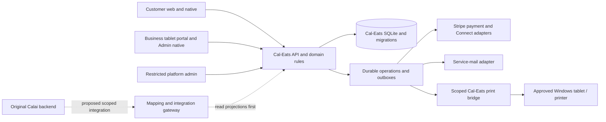

# Cal-Eats developer overview and Calai business integration handover

Prepared 30 October 2026. **Status: work in progress / preproduction.** This is an architecture and implementation handover, not production approval, a completed integration, or a certification of capacity, payments, physical printing or store readiness.

The inspected Cal-Eats integration checkout is based on commit `c1f07e557a165980c8571393188e92f866291596`, with later business-settings, finance, automatic-alert and customer-offer work in progress. Migration history is still changing in this working tree; confirm the final reviewed commit, applied migration list, deployed image and live schema separately before planning changes against a running environment. Dated audit results below describe their own baselines; they are not blanket test results for later work.

## Repositories and source evidence

| Component | Repository / location | Verification scope |
| --- | --- | --- |
| Cal-Eats, including all customer/business clients and its independent bridge | [MohammedCalai/cal-eats](https://github.com/MohammedCalai/cal-eats) | Matches this checkout's configured Git remote. All Cal-Eats components live in this monorepo. |
| Original Calai Operations platform | [calai-operation/calai-platform](https://github.com/calai-operation/calai-platform) | Recorded in `SOURCE_PROVENANCE.json` and the original source-reuse audit. The inspected historical source is commit `ab138fd17c9ac4fc6e0b34ef5044754be643056c`; this does not establish today's deployed revision. |
| Original Calai Thermal Print Bridge | [Pinned bridge source](https://github.com/calai-operation/calai-platform/blob/ab138fd17c9ac4fc6e0b34ef5044754be643056c/backend/print-bridge.js) and [Intune package](https://github.com/calai-operation/calai-platform/tree/ab138fd17c9ac4fc6e0b34ef5044754be643056c/backend/intune) | Found inside the original Calai repository. No separate bridge repository URL has been verified; do not assume a third repository exists. Cal-Eats' replacement protocol/client is separately located at `apps/print-bridge` in its own monorepo. |

These are private-repository references and do not grant access. Developers need their own existing, appropriately scoped GitHub permissions. This handover does not invite users, change access, disclose credentials or authorize modifications to the original Calai system. The historical reference snapshot is ignored and may not accompany a fresh clone; use the source provenance and authorized original-repository access.

The connected GitHub lookup returned Not Found for both known repository URLs during this handover. Treat that as an access/visibility limitation, not proof that either repository was deleted. The Cal-Eats remote and original Calai historical provenance remain the verification sources above; authorized maintainers must confirm current default branches and deployed revisions.

## Product surfaces and code map

There are **two native apps** and one shared Cal-Eats backend. Business-owner and platform-administrator web screens are permission-separated surfaces of the same business portal, rather than independent databases or additional customer apps.

| Source | Purpose / stack |
| --- | --- |
| `apps/web` | Customer browser/PWA: discovery, menus/options, basket, delivery/collection checkout, orders, offers, messages, support, saved addresses and account settings. Vanilla JavaScript/HTML/CSS, service-worker public shell. Includes a landing page. Legacy business UI remains in this bundle; the React portal is the main business surface. |
| `apps/mobile` | Customer **Cal-Eats** app: Expo/React Native, native secure session storage, customer journeys and foreground notification/reminder UI. Configured native identifier: `uk.co.calai.caleats`. |
| `apps/portal` | React/Vite business tablet/phone web portal: owner/staff order handling, menu/photos/options/import, customer CRM/inbox, marketing, refunds/support, finance/payout visibility, printers/settings. Platform-admin routes add approval, oversight and operational controls under a distinct role. |
| `apps/admin-mobile` | **Cal-Eats Admin** business-owner/staff phone app, using the same restaurants, menus, orders and APIs. It is not a platform-administrator privilege grant. Expo/React Native; configured identifier `info.calai.caleatsadmin`. |
| `apps/api` | Node 24 HTTP API, authorization, SQLite persistence/migrations, business rules, provider adapters and durable workers. Composition entry `src/app.js`; process/worker entry `src/main.js`. |
| `apps/print-bridge` | Independent Cal-Eats Node device agent: pairing, authenticated job claim/ack, local journal, receipt formatting and transport adapter. File-sink simulator is the verified default; physical transport is separately gated. |
| `packages/contracts` and `scripts` | Shared pure rules/contracts; developer checks, release/database preflight, backup/restore checks, synthetic verification and migration-export tooling. |

The root manifest pins Node **24.19.0** / npm **11.17.0**. Native source currently targets Expo SDK 57 / React Native 0.86. The existing hosted preview URL is [eats.calai.info](https://eats.calai.info): customer `/order/`, business sign-in `/business/login`, with owner/staff and platform-admin routes behind authorization. The customer and Admin native projects are separately configured under the approved Expo owner. A build profile or app identifier alone is not evidence of an uploaded, signed or device-accepted release.

The dotted integration is a proposal, not an implemented connection.

## Backend, storage and identity

Cal-Eats is a modular monolith with separate delivery clients. The API uses built-in Node HTTP and SQLite, with WAL, foreign keys and synchronous transaction boundaries. Domain files include ordering/journey, marketplace finance, loyalty/marketing, customer relationships, support/disputes, payments and printing. Public assets are bundled; transaction records and bounded catalog/evidence media are persisted by the API. Runtime database, keys, logs, journals and private mail artifacts are outside Git.

Use stable UUIDs for users, restaurants, memberships, menu items and orders. Restaurant access is derived from authenticated `restaurant_memberships`, including owner/staff permission; a client-supplied restaurant ID is never authority. Customers access their own records, owners their restaurants, staff their permitted operations, and platform administrators their explicitly restricted oversight routes.

Passwords are hashed. Hosted browser sessions use server-side records and protected cookies with host/origin checks; customer-native and business-native bearer sessions are distinct and revocable, with tokens held in native secure storage. Printer pairing/device credentials form another separate authentication boundary. Do not share Calai JWT signing keys, sessions, passwords or broad administrator tokens with Cal-Eats. There is no implemented cross-system SSO or automatic identity linking.

## Business rules and current workflows to preserve

- **Catalog and delivery:** owners manage menu items, photos, prices, extras, allergens and availability, hours/pause state and delivery settings. Restaurants provide their own delivery drivers. Delivery eligibility, fees and minimums are rechecked by the server; outward postcode matching and configured service-area checks must survive integration.
- **Ordering:** checkout uses server prices and immutable item/fulfilment/payment/commission snapshots. Reviewed totals are checked again when creating an order. Idempotency keys protect retries; a different payload with the same key must fail. Confirmation requires a business decision and customer ETA. Delivery progresses through preparing, ready, out for delivery and completion; collection has its corresponding ready/collected path. Do not create another order merely to project it into a combined dashboard.
- **Customers and marketing:** CRM search, paging, workflow statuses, private notes, own-customer conversations, order messages, support and refund cases are separate access-controlled contexts. Promotions are restaurant-funded, consent-aware and exclusive. The current campaign builder supports item/order percentage discounts, fixed order discounts, purchase-linked gifts, BOGO, free delivery and a single timed happy-hour window. Server quotation and reservation enforce eligibility, dates, redemption limits and lifetime/weekly spend caps; gift value and waived delivery consume promotional budget. Weekly budget boundaries are Monday in Europe/London. Do not describe happy hour as recurring scheduling or invent paid placement/AI optimization.
- **Reporting:** dashboard presets use London calendar windows. Order-cohort dashboard figures and event-date weekly financial statements have different declared bases; they must not be summed or silently renamed. Cash paid to the restaurant, platform commission receivables, captured card payments, connected-account transfers and bank payouts remain different measures.
- **Business settings and finance presentation:** current local UI work groups business profile/cover photo, hours and order timing, delivery, message settings, team membership and the signed-in person's contact details into explicit edit/save flows. The finance workspace separates overview, bank/payout history and paged order statements; the operational dashboard concentrates on active orders and customer messages. Owners retain financial access and staff retain their permitted operational access. Masked bank information and Stripe-reported payout state are distinct from internal available/pending/held balances; bank-detail changes leave Cal-Eats for an approved Stripe page. These presentation changes still require the final integrated build and device acceptance.
- **Customer offer list:** the current local change adds per-customer grant dismissal and bounded active-offer pagination. Dismissal hides that customer's offer, rather than deleting its campaign, financial history or another customer's grant; an offer reserved against an unresolved order cannot be dismissed. Migration 33 and its API/client changes are part of the in-progress release, so verify their presence and export coverage in the final deployed migration history.
- **History:** keep original names/prices, integer GBP pence, discounts/allocations, modifiers, delivery details, accepted commission rate/base/version, refunds and provider references. Later menu or policy edits must not rewrite historical money.

## Notifications, service mail and payments

Cal-Eats stores recipient-scoped notification events and uses its own live stream with reconnect replay/deduplication. Customer order updates, restaurant/customer messages, personal offers and support replies link to their authorized records. New-order business confirmation alerts and three-minute overdue escalation are distinct from customer reminder sounds. Browser/native in-app audio is foreground behavior; dependable APNs/FCM background or locked-device delivery still needs implementation/acceptance evidence.

Current local business-alert work enables new-order sound by default rather than carrying forward a stored mute preference. The authenticated pending-confirmation queue owns the repeating alarm: minimising the dialog, opening the notification bell or changing the selected restaurant does not confirm or silence waiting orders. Browser playback is prepared through a trusted interaction and remains subject to browser permission and device volume; the native foreground player likewise stops when the app is inactive. Confirmation/rejection must succeed on the server before the pending order is removed. Do not advertise this as a guaranteed background, locked-device or physical-tablet alarm without device evidence.

Transactional and weekly business emails use durable outboxes with local-preview, SMTP or Microsoft Graph adapters. Recipient ownership/membership and current account details are checked before sending. Provider acceptance is not proof of inbox delivery; an ambiguous dispatch is held for review rather than blindly resent. Weekly owner statements cover the previous Monday–Sunday and are scheduled Monday at 09:00 UK time. Repository records describe a separately approved hosted service-mail connection and weekly sending activation; developers must verify the deployed transport/configuration and delivery status rather than assuming local defaults describe the host. Account recovery/verification delivery remains a separate unfinished gate.

Stripe integration uses hosted Checkout and Connect adapters; the API does not accept raw card or bank details. Verified authorization makes card orders merchant-visible, acceptance performs capture through a durable decision, and later workers handle reviewed refunds and restaurant transfer eligibility. Return URLs do not prove payment. Test and live modes, account binding, signed platform/Connect webhooks, idempotent operations and unknown-outcome recovery must remain separate. Source documentation records genuine sandbox authorization/capture/refund trials, but not completed real bank payout acceptance or live-payment sign-off. Review [PAYMENT_PROVIDER.md](PAYMENT_PROVIDER.md), the trial record and finance audit before any live-money change. Calai SaaS subscription billing is a separate financial context from Cal-Eats marketplace orders.

## Printing and Windows/Intune boundary

Successful business confirmation already creates one original queue job per enabled Cal-Eats restaurant printer. Repeated confirmation and later status changes must not create another original job. The paired bridge receives authenticated jobs; browser receipt viewing is not physical output. Manual copies are explicitly labelled.

Original Calai's bridge/Intune installation and per-tablet configuration are **not** interchangeable with the Cal-Eats protocol. Preserve the existing Calai startup task, files, pairing, credentials and current printer ownership. Source review cannot establish the installed Surface model, Windows/runtime, USB/LAN driver, paper width, code page, cutter behavior or actual paper output.

The dated audit reproduced an expired-claim duplicate-dispatch path (PP-01). That remains a gate for unattended physical rollout or a combined spooler: require server dispatch fencing, durable ownership/journal recovery and explicit uncertainty handling, with two-device/sleep/restart/lost-ack tests. A raw socket write is not proof that one piece of paper printed. One physical printer needs one delivery authority for each canonical order; a read-only integration projection must never trigger another receipt.

## Clean combination with Calai: recommended sequence

1. **Confirm both live baselines first.** Obtain the current Calai deployed commit/API/schema and print topology from its authorized team. Original reference evidence shows Express, Prisma/PostgreSQL, React, Redis, phone/call workflows and different authentication. It is not Laravel, and the old snapshot is not proof of current production behavior.
2. **Preserve Cal-Eats and add a scoped read-only gateway first.** Keep its routes, role checks and business rules intact. Link each Cal-Eats restaurant explicitly to a verified Calai business; activation and source permissions are checked server-side for every route and stream. Names, emails and a user's first owned business are not identity mappings. Separate login/PKCE or delegated authorization is proposed work, not an existing supported Calai endpoint.
3. **Keep source-qualified identities and one source of truth.** Use `(sourceSystem, sourceEntityId)` and reviewed crosswalks such as `cal-eats:restaurant:<id>` versus `calai:business:<id>`. Preserve aliases for existing URLs/native IDs. Phone-order projections route acceptance/refund commands to their source; they do not call normal Cal-Eats checkout, capture twice, charge another commission or print again.
4. **Agree versioned event and metrics contracts.** Use authenticated tenant-bound subscriptions, durable outbox/inbox deduplication, event/entity versions, retries and reconciliation. Do not reuse the historical Calai Socket.IO room-join implementation until the deployed version's authentication/membership controls are checked; the snapshot has a confirmed authorization gap. Keep call counts distinct from orders and unpaid phone-order value distinct from captured sales.
5. **Rehearse data movement and cutover separately.** `scripts/export-migration-package.js` provides the documented read-only, system-qualified v1 export, not an importer or complete backup. Review its coverage against the final release's applied migration history, including campaign rules/budgets, customer offer-dismissal state and new menu fields. Authentication material, operational queues and important correspondence/evidence details are deliberately excluded or require a separate approved transfer. Reconcile identities, permissions, counts, money and snapshots on isolated staging data before any cutover.
6. **Stage printer ownership and rollback explicitly.** Do not run old/new consumers for the same job. Drain, reconcile external outcomes and transfer ownership under supervision. Database rollback cannot undo a capture, refund, transfer, email or receipt; never restore old data and replay those actions blindly.

The detailed proposed integration contract and phases are in [CALAI_INTEGRATION.md](audit-2026-10-30/CALAI_INTEGRATION.md); the data crosswalk/export limits are in [MIGRATION_HANDOFF.md](MIGRATION_HANDOFF.md).

## Developer starting point and remaining gates

Use a fresh checkout, the pinned toolchain and a new synthetic database with simulated payments/local mail. `npm ci --ignore-scripts` and `npm run check:developer` are the documented onboarding checks. The latter sanitizes inherited provider/application configuration and runs repository checks; it is not approval to start existing-data migrations or providers. Normal startup may apply migrations unless explicitly disabled. Review [OPERATIONS_RUNBOOK.md](OPERATIONS_RUNBOOK.md) before using any existing database, backup or deployment setting.

The dated first-remediation batch records fixes for notification replay, concurrent message retry, schema-version refusal, redacted error correlation, temporary-chat backup exclusions and release tooling. It also records complete local Windows validation. GitHub Actions was blocked by account billing/spending restrictions, not established as passing CI; branch protection and Linux/container evidence must be verified independently. Later customer/marketing/finance work has its own focused evidence and still needs integrated release/device acceptance.

Priority work remains: printer dispatch fencing and physical acceptance; provider-originated refunds/disputes and held-transfer recovery; secure real account recovery and privileged-access hardening; durable worker throughput/observability; protected off-host backups/key recovery and restore drills; dependency advisory review; verified store signing/device/background notification paths, privacy/deletion and release-review requirements. Existing release-readiness flags remain unapproved. Neither a verified 10,000-business capacity nor a completed Calai merge is claimed.

Start with [DEVELOPER_READINESS.md](DEVELOPER_READINESS.md), then the dated [audit report](audit-2026-10-30/REPORT.md), [API reference](audit-2026-10-30/API_REFERENCE.md), [payment/printing review](audit-2026-10-30/PAYMENTS_PRINTING.md), [capacity plan](audit-2026-10-30/SCALABILITY.md) and current feature-specific API documents. Assign owners and acceptance evidence per slice; keep historical audit findings dated rather than rewriting them as if later work had always been present.

No secrets, test passwords, customer records, bank details, access tokens or private key material are included in this handover.

## Validation for this handover update

The business Settings save/restore flow and all three Earnings views were reviewed against disposable local fixtures at phone width. Customer offer removal was exercised through the browser, followed by reload/reopening the list: the dismissed offer remained absent, the first page contained 20 offers and the next page stopped at the final items. These checks sent no customer email and did not create live payments.

Focused offer API/lifecycle/renderer and automatic-order-audio/confirmation-policy checks passed. Both native applications passed TypeScript checking; the business portal production build and release packaging check passed. The portal still emits its existing large-bundle advisory. These are targeted change checks, not a new exhaustive audit, physical sound/device certification or evidence of a new TestFlight binary. The independent production gates earlier in this document remain open.
