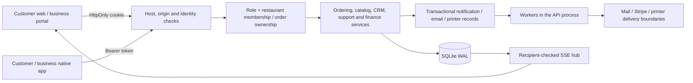

# Backend, database and tenant isolation audit

Audit date: 30 October 2026. Source baseline: `b94092ee4657b01d93466a4ddf282155f76a0fa2`. Scope: the local Cal-Eats API, including its current route registration, schema, authorisation, messaging and workers. Findings concern this source baseline; production configuration and production data were not inspected. No application changes or existing-database migrations were performed.

The backend has useful foundations: parameterised SQL, central role/membership helpers, hashed session tokens, strict hosted write origins, immutable order snapshots, transaction boundaries and substantial domain tests. It is a single-process application with several broad modules, synchronous database work and incomplete operational visibility. It is not yet evidenced for 10,000 businesses. Retain the working domain logic; fix the measured query and reliability problems before extracting modules or changing database engines.

## Evidence and interpretation

`confirmed` means established by source inspection or the isolated reproduction described here. `conditional` describes an impact that depends on unverified hosting or workload. `proposed` is work that requires approval before changing the application.

An in-memory database created only for this audit successfully applied all 31 registered migrations: **85 tables**, **57 explicitly declared indexes**, **149 foreign-key edges**; `integrity_check=ok`, zero foreign-key violations. This validates a fresh schema, not an upgrade of existing production data. See [schema reference](SCHEMA_REFERENCE.md), [API reference](API_REFERENCE.md) and [machine-readable evidence](BACKEND_EVIDENCE.json).

## Prioritised findings

| ID | Priority | Finding and evidence | Impact and proposed correction |
|---|---|---|---|
| BE-01 | P1 before scale | **Confirmed:** `journey.js:127` retrieves every approved restaurant, executes correlated order/menu queries, then filters in JavaScript. The menu subquery has no restaurant index; in-memory `EXPLAIN QUERY PLAN` reports `SCAN m` inside the correlated subquery. `service-areas.js:15-23` separately reads all approved restaurant coverage on each availability request. | Public discovery cost grows with all tenants and all menu rows, even for a narrow postcode. Add tested menu lookup indexes, SQL filtering and bounded pagination/search; cache read-only coverage with explicit invalidation. Preserve existing cuisine, postcode, popularity, availability and menu-search semantics. Measure current versus proposed plans on realistic cardinalities before approval. |
| BE-02 | P1 before scale | **Confirmed:** `journey.js:70-85` executes separate restaurant, items, events, refunds, Stripe and ledger queries for each order DTO. Current schema query plans show full `order_items`, `order_events` and `ledger_entries` scans, with temporary sorts for the latter two. `journey.js:235-265` leaves customer history, administrator lists and default business lists unbounded; business pagination is opt-in. `operations.js:71-83,237-238` also materialises whole statements/jobs/CSV datasets. | Repeated scans amplify latency and block unrelated requests. Candidate indexes: `order_items(order_id)`, `order_events(order_id,created_at)`, `ledger_entries(order_id,created_at)`, `ledger_entries(restaurant_id,created_at)`, `menu_items(restaurant_id,available,sort_order,created_at)`. SQLite indexes include rowid as the tie-breaker. Validate planner choice, write cost and storage before adding them. Batch child reads and introduce compatible, explicit paged API contracts before changing existing callers. |
| BE-03 | P1 before live reliance | **Confirmed by reproduction:** notification reconnect with 150 unseen stored events delivers only 100 after the hub starts. `notification-stream.js:42` initialises its global cursor to the maximum existing rowid; lines 72-74 cap per-client catch-up at 100, without continuing from that cursor. The regular poll cannot recover the remaining earlier rows. | A long-disconnected device can miss notification-driven updates until a separate data refresh. Do not treat SSE as an authoritative order queue. Implement bounded continuous catch-up or an explicit gap/resync event, retaining recipient authorisation and backpressure checks. Regression: 150/1,000 missed events, process restart, reconnect during writes, cursor deletion and session revocation. |
| BE-04 | P2 | **Confirmed by concurrent reproduction:** two identical order-message POSTs using one idempotency key return `[201,500]` with a single stored row. `order-messaging.js:149-159` checks replay before `await encryptMessage`, then inserts without another replay lookup inside the transaction. | The uniqueness constraint prevents duplicate storage but a legitimate concurrent retry fails. Recheck replay/hash inside the transaction, as `support-cases.js:161-166` already does. Preserve conflict responses for the same key with different content. This audit did not find duplicate orders from this message defect. |
| BE-05 | P1 before hosted rollout | **Confirmed implementation; hosting impact conditional:** auth rate keys use `req.socket.remoteAddress` and an eight-attempt-per-minute IP bucket (`app.js:50,55-70`, `config.js:77`). There is no trusted-proxy client-address extraction. | Behind a shared reverse proxy, unrelated customers may share one quota. Verify the actual ingress topology first; use an explicitly trusted proxy chain and independently enforced identity/IP limits. Never trust arbitrary forwarded headers. Add overload limits to the scrypt waiting queue (`auth/passwords.js:8-15`); the two-active-job cap does not bound pending jobs, and owner-created staff bypass the auth endpoint limiter. |
| BE-06 | P1 before independent operation | **Confirmed:** request failures are returned but not logged (`app.js:207-213`). Worker errors have only console messages (`main.js:32,49`); readiness checks migration presence (`app.js:82-84`) rather than worker age, queue lag, disk or provider health. | Diagnosis, response-time evidence and incident detection are incomplete. Add request IDs, sanitised structured server-error logs, request/DB/event-loop timings, queue-age gauges, worker heartbeat, disk/WAL metrics and actionable alerts. Keep security-sensitive readiness details internal and do not log tokens, messages, addresses or payment payloads. |
| BE-07 | P1 before release | **Confirmed:** `main.js:20-21` opens and migrates the configured database before listening. Versions 2, 3, 15 and 22 rebuild tables with foreign keys temporarily disabled. `schema_migrations` records version/name/time, not checksums or a maximum-supported-schema guard (`db/index.js:14-35`). | A normal start can mutate persistent data and an old image can start against a newer schema; rollback is not just changing the image tag. Introduce a separately controlled migration release step after approval, immutable migration checksums and compatibility checks. Rehearse each supported upgrade on a restored synthetic or authorised redacted copy; verify row counts, constraints, money totals, indexes and app compatibility. No migration was applied to existing data during this audit. |
| BE-08 | P1 before public account recovery | **Confirmed:** password reset and verification issue links only into `local_mail_sink` (`account-access.js:16-20,35-41,59-63`) regardless of hosted mode. The customer transactional email worker does not make this account-access path a delivery adapter. | A complete-looking recovery UI is not evidence of real email delivery. Implement and test a dedicated recovery sender with token redaction, one-use/expiry guarantees and generic outward responses, or keep the public release gated until delivery is verified. Preserve the current protections that revoke all sessions on reset. |
| BE-09 | P2 | **Confirmed:** AES-GCM order/customer/support replies use a single configured key; decryption rejects other key versions (`message-encryption.js:37-43,65-78`). `loadConfig` does not expose a multi-key lookup. Support case initial text is plaintext (`support-cases.js:133`); order contact/address snapshots and local reset mail are also plaintext. | The application does not encrypt all personal data at rest. Document exact coverage, authorised access and retention. Establish protected backups, disk/storage encryption and a tested rotation strategy with historical key lookup before rotating the message key. Changing the single key in place makes old messages unreadable. The audit did not inspect host encryption or access controls. |
| BE-10 | P2 | **Confirmed:** broad routing modules combine HTTP parsing, authorisation, SQL, DTOs and domain transitions. `product.js:63-76` still contains legacy support handlers that are shadowed by `routeSupportCases` earlier in `app.js:190`. Native and browser identity validation/login paths are duplicated (`app.js`, `native-auth.js`). `sessions_token_hash_idx` duplicates the UNIQUE token-hash lookup index. | Preserve behaviour while extracting narrow shared functions and eliminating proven shadowed paths after regression coverage. Do not delete modules based on filename or apparent age: several legacy-looking payment/finance paths remain active. Native login accepts legacy hashes but does not upgrade them as browser login does; unify only with tests. |
| BE-11 | P1 before privileged live operation | **Confirmed source gap:** authentication is password/session based; no second-factor or step-up flow was found in the routed admin/owner controls. | Require a reviewed privileged-access design, session/access review and audit coverage before enabling live administrative money/account actions. This is a missing protective layer, not evidence of an existing cross-tenant exploit. Preserve the restaurant staff/owner distinction. |
| BE-12 | P2 | **Confirmed suite failure; cause established from source:** the expiry test backdates an order to 2020 (`finance-operations.test.js:67`), expires it to terminal rejected, then expects the customer GET to succeed at line 70. The current 90-day history middleware correctly excludes it (`app.js:91`, `customer-order-history.js:13-25`). | Correct the stale expiry fixture to an age over the expiry threshold but within 90 days, retaining a separate old-terminal-order 404 test. Do not weaken the history rule merely to make the old assertion pass. |

Priorities mean P1 = release/scale gate for the affected capability, P2 = planned reliability/maintainability work. No confirmed unauthenticated cross-tenant data disclosure was reproduced in this backend review. That is not a penetration-test certification.

## System and data flow

`main.js` owns one SQLite connection, starts workers and the built-in Node HTTP server, then schedules the general worker every 60 seconds and transactional email/confirmation workers every five seconds. All share the API process. A failure in the sequential general worker body prevents later worker functions running during that cycle. Timers use in-process overlap guards; selected durable jobs also have database leases. This is not a distributed scheduler.

Request processing in `app.js` is ordered: security headers and host validation; public runtime/health; provider webhook handling; cookie/native identity; customer history window; write-origin checks; account/native authentication; static assets; feature route dispatch. Feature routes execute prepared SQL directly. Standard successes are `{data: ...}` and errors `{error:{code,message}}`; HTML receipts, media, CSV and SSE are explicit exceptions. Pagination is inconsistent across old and new routes, so clients must follow the route-specific contract.

Order creation validates the customer, restaurant status/availability, service area, menu choices/prices, fulfilment, payment selection and idempotency hash, then writes the order, immutable items/events and relevant notifications in a transaction (`journey.js:299-402`). Status transitions validate allowed state, role and membership; Stripe decisions cross a separately reconciled external boundary (`journey.js:405-467`). Currency values are integer minor units; policy, price, name, allergens, modifier and customer snapshots protect historical order records. Do not replace those snapshots with joins to mutable current data.

The database is single-writer SQLite WAL with foreign keys enabled, a five-second busy timeout and synchronous execution (`db/index.js:7-10`). WAL permits readers alongside a writer; it does not make this Node connection or JavaScript event loop concurrent during SQL. A long query or busy wait delays other requests. Running more replicas against independent copies creates inconsistent state; sharing a SQLite file on general network storage is not an approved scaling design. The appropriate long-term database/worker topology needs the staged workload evidence described in the main scalability plan.

## Tenant and authentication model

| Actor | Identity and permitted data |
|---|---|
| Anonymous | Approved restaurant discovery/menu, public media under route checks, availability/location lookup, runtime/health/payment configuration, registration/login/recovery, signed webhooks and pairing entry point with their separate credentials. |
| Customer | Own account, addresses, sessions, offers/consent, orders, messages, support and refund cases. Ordinary order-history visibility is 90 days plus active orders (`customer-order-history.js`); account export intentionally reads all retained own orders. |
| Restaurant staff | Current membership in the requested restaurant; operational menu reads, order workflow, order messaging and scoped support. Owner-only financial/administrative tools are denied. |
| Restaurant owner | Membership with `permission='owner'`; staff creation, catalog/profile/configuration, customer CRM, offers, finance, statements, printer administration and owner-only integrations. |
| Platform admin | Explicit role check; cross-restaurant administration, governance, finance and support. Order-message content reads require a reason and audit event. |
| Print device | Separate hashed token tied to a printer/restaurant, revocation and job-claim checks; not a restaurant browser session. |
| Payment webhook | Signature and configured mode/account checks before event intake; not a browser-origin exception granting a user identity. |

Browser sessions are random 32-byte tokens with SHA-256 hashes stored in `sessions`, 24-hour default lifetime and HttpOnly/SameSite=Strict cookies, Secure under hosted mode (`auth/sessions.js`). Native customer/business sessions are separate audience tables with 30-day tokens (`native-auth.js`). Supplying an invalid Bearer token deliberately prevents fallback to a valid cookie (`app.js:87-90`). Password hashes use salted scrypt and bounded active hashing; missing users pay a dummy hashing cost (`auth/passwords.js`). Reset tokens are hashed, expiring and single-use; successful reset revokes browser and both native session types.

Tenant isolation is application-enforced: `requireRestaurantMembership`, `requireRestaurantOwner`, order ownership, and resource-specific access helpers. There is no database row-level security. Foreign keys verify that referenced IDs exist but generally do not assert that two independently referenced rows belong to the same restaurant. Consequently any new import/integration/admin path must prove tenant consistency inside its transaction and must not trust a restaurant ID merely because it came from a browser. Introduce composite constraints only where compatibility has been assessed; do not claim this is a confirmed exploit in existing guarded routes.

Existing tests exercise other-restaurant access, staff restrictions, disabled accounts, mixed bearer/cookie behaviour and stream revocation: `journey.test.js`, `product-operations.test.js`, `governance.test.js`, `business-support.test.js`, `customer-relationships.test.js`, `dashboard-exports.test.js`, `marketplace.test.js`, `order-messaging.test.js`. Before adding Calai, expand this into an explicit actor × tenant × route × resource matrix, including swapped nested IDs, archived membership, activation revocation, export/download links and stream replay.

## Database ownership and relationships

`users` is the identity root; `restaurants` is the business root. `restaurant_memberships(restaurant_id,user_id)` forms the many-to-many relationship and stores owner/staff permission. A user belongs to one role, and may have multiple restaurant memberships.

`orders` belongs to one restaurant and one customer; its idempotency uniqueness is `(customer_id,idempotency_key)`. `order_items`, `order_events`, `refunds`, `ledger_entries`, payment records, print jobs and message threads reference an order. `menu_items` belongs to a restaurant; media references are stored in menu/restaurant rows. Several fields are JSON text rather than separate tables: modifiers, allergens, opening hours, delivery areas, order addresses and snapshots. Input validation is part of their integrity boundary.

Financial state is spread across legacy `ledger_entries`, marketplace operation/journal records, refund cases, payouts and Stripe payment/decision/account records. These are distinct accounting and operational views, not interchangeable totals. Preserve their source identifiers and reconciliation rules. Messaging uses per-order or per-restaurant/customer threads and per-user read state. Customer conversations use durable per-thread ingestion sequences; order chats still order by timestamp and UUID. Support correspondence has a separate retention policy from 30-day order/customer chats. Notification/email outboxes have uniqueness keys for delivery deduplication. See all columns, keys and relationships in [SCHEMA_REFERENCE.md](SCHEMA_REFERENCE.md).

## Migration, retention and recovery handover

Treat the migration array in `db/migrations.js` as the ordered schema authority. Source modules supply versions 17 onward; versions 30/31 are exported from `menu-details.js` and `service-areas.js`. There are additional historical helper migration functions in some modules; they should not become an alternative production migration runner. Registered versions are not evidence of migration-file immutability because checksums are absent.

Before an approved database change, record the exact source image and schema version; take and verify a consistent SQLite backup with required encryption keys and provider configuration references; restore to an isolated path; rehearse the upgrade; compare counts and money invariants; run regression tests; and demonstrate recovery to a compatible image/database pair. Never copy only a live `.sqlite` file and discard its WAL as an assumed backup. Follow the existing backup/restore tooling after checking its destination and key handling. No destructive downgrade script is established by this audit.

Retention exists for expiring order/customer messages and some evidence; no comprehensive bounded lifecycle was found for sessions, local reset mail, notifications, audits, job histories and report artifacts. This is a storage and privacy-governance issue, not an instruction to delete records. Obtain an approved per-data-category policy, keep financial/audit obligations separate, and implement incremental deletion/archive jobs with measured lock duration and restore tests.

## Reproduction details and regression requirements

The audit used a fresh `:memory:` database and temporary `journeyFixture` databases only, with provider defaults left in simulation mode. Node runtime was `v24.19.0`. No existing data files or environment secret files were read.

Query-plan evidence is reproducible by importing `openDatabase`/`migrateDatabase`, opening `:memory:`, applying registered schema and running `EXPLAIN QUERY PLAN` on the SQL saved in [BACKEND_EVIDENCE.json](BACKEND_EVIDENCE.json). Empty-schema plans establish missing access paths; they do not establish production latency or capacity. Test proposed indexes against populated staging data before accepting them.

SSE reproduction: insert a synthetic customer, a valid session and 151 notifications named `n0` to `n150`; create a new hub after insertion; subscribe using `lastEventId='n0'`; call `poll()`. Expected 150 unseen notifications, actual 100, `n150` absent and 50 records still undispatched. The database still retains the records, so a correctly implemented REST refresh can recover business data.

Message retry reproduction: create a synthetic active cash order and customer session using the existing isolated fixture; concurrently submit two identical POSTs to `/api/orders/{id}/messages` with the same `Idempotency-Key`. Observed 201 and 500 (`ERR_SQLITE_ERROR`) and exactly one message row. An acceptable fix returns the created/replayed resource for both requests and 409 for conflicting content, without duplicate notification/email work.

Further regression coverage required before refactoring: populated upgrade fixtures from every supported deployment version; migration restart/partial failure; process death during transaction and after external acceptance; replay after restore; tenant isolation for every route; auth behaviour through the real trusted proxy; queue fairness under one noisy restaurant; representative 10,000-tenant query plans; and a browser/device test proving refresh recovery when SSE skips or disconnects. The main audit records whole-suite execution; this document does not infer coverage from test filenames or from UI completeness.
