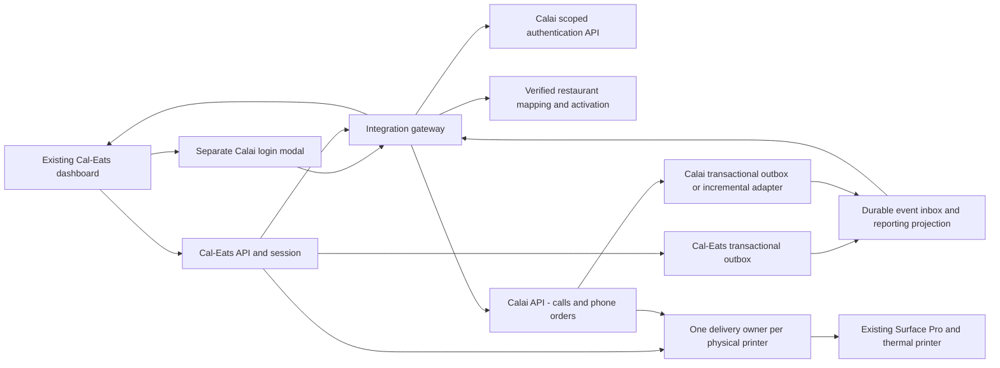

# Calai Phone Ordering integration design — approval-stage proposal

This is a design and development plan, not an implemented connection. Preserve the existing Cal-Eats interface, routes, features, contracts and business rules. Use a separate testing repository and staging environment before changes can reach either live system. No repository merge, shared production database, production migration, provider mutation or device installation was performed for this audit.

## What is known about the two systems

Cal-Eats baseline `b94092ee4657b01d93466a4ddf282155f76a0fa2` is an npm workspace: built-in Node HTTP/SQLite API, React restaurant portal, vanilla customer web application, two Expo native applications and a Node print bridge. Browser sessions are server-side records addressed by secure cookies in hosted mode; native and print-device credentials are separate. The business portal already has owner/staff checks and restaurant-scoped views.

The accessible Calai reference is an ignored, read-only source snapshot at `reference/calai-platform-ab138fd`, commit `ab138fd17c9ac4fc6e0b34ef5044754be643056c`, documented by [SOURCE_PROVENANCE.json](../SOURCE_PROVENANCE.json). It is not evidence of the current deployed release. Static inspection shows Express, Prisma/PostgreSQL, JWT authentication, Socket.IO, phone order/call reporting and a separate printer protocol. Nothing in the reference was executed or modified during this audit.

Relevant **existing reference** endpoints under `/api`:

| Route family | Intended role/use in reference | Integration constraint |
| --- | --- | --- |
| `/auth/login`, `/auth/refresh-token`, `/auth/logout` | Calai user authentication | Not an existing delegated SSO protocol; do not invent token exchange support |
| `/business-owner/dashboard/stats`, `/insights`, `/live` | `BUSINESS_OWNER` dashboard and live calls | Adapter must resolve and verify the explicit linked business |
| `/business-owner/order/`, `/:id` | `BUSINESS_OWNER` order reads | Phone orders remain Calai-owned records |
| `/business-owner/call-summary/`, `/summary/:id`, `/transcript/:id` | Call history/detail/transcripts | Separate access and retention scope for transcripts/recordings |
| `/printer/poll` POST/GET/DELETE | Calai's existing printer protocol | Not interchangeable with Cal-Eats device pair/claim/ack |

Evidence: reference `backend/src/app/router/index.js`; module `*.route.js` files for auth, businessowner/order, dashboard, call-summary and printer/device-printer; `backend/prisma/schema.prisma`. Dashboard service examples use `business.findFirst({where:{ownerId:userId}})` (for example lines 418-425). This implicitly chooses one owned business; it is not adequate proof of the selected Cal-Eats restaurant's mapping for multi-business owners.

**Integration security gate:** reference `backend/src/app/utils/socket.js:7-26` permits connections and joins a caller-supplied `businessId` room without authentication or membership verification. Its order notification payload includes customer details at lines 52-68. This is a confirmed weakness in the snapshot, not a verified exploit against a live endpoint. Do not expose or reuse this stream in the integrated dashboard until the deployed version has been checked and staging enforces authenticated tenant-scoped subscriptions. Cal-Eats' own recipient checks must remain in place.

## Boundaries and data flow



The integration gateway is a small separately maintainable service or an isolated module with its own API boundary, configuration and tests. Choose deployment packaging after measuring operational cost; do not split existing Cal-Eats features into many services just to add navigation. Each backend retains its own database, migrations, payments, order state machine and release lifecycle. Integration projections are rebuildable views, never an alternative financial ledger.

### Identity, activation and separate login

1. Keep Cal-Eats login unchanged. When an authenticated restaurant is eligible, show a small Calai connection entry **below all existing Cal-Eats navigation items**, preserving order, styling and responsive behaviour. Non-activated/unauthorised restaurants receive no Calai feature menu or data. A platform-managed eligibility record determines whether the connection entry itself is visible.
2. Open a separate Calai login modal with an accessible title, focus trap, close/back behaviour and independent error state. Clearly identify the account being connected and restaurant being linked. Calai login failure must not clear or replace the Cal-Eats session.
3. Prefer a new scoped authorization-code/PKCE flow on the independently maintained Calai staging backend. It is a proposal; the reference does not supply it. An alternative approved gateway login can forward credentials over TLS directly to Calai and discard them immediately, exchanging the result for a scoped integration session. Never store a Calai password, return a refresh token to localStorage, or share signing keys across systems. Do not embed a broad Calai administrator token in the browser.
4. Verify Calai's returned user and business membership on the server. Persist a reviewed mapping `calEatsRestaurantId ↔ calaiBusinessId` plus integration principal, approved scopes, activation status and audit record. Never infer this mapping from a name, email domain, arbitrary browser `businessId` or the first owned business.
5. Require both current Cal-Eats membership and current Calai integration scope/activation on **every** integration route, command and stream subscription. Map staff permissions explicitly; Calai owner access must not silently grant Cal-Eats staff finances or recordings. Return non-enumerating failures for other tenants.
6. Keep the integration session in an HttpOnly, Secure, appropriately SameSite cookie or server-side vault reference, with CSRF/origin checks. Reauthentication, token refresh, logout, unlink, tenant switching, suspension and account removal must revoke access and clear cached data. Disable feature access immediately server-side; revocation also closes streams. UI hiding is not authorization.

Proposed additive API surface (names provisional): `GET /api/integrations/calai/status`, `POST /connect/start`, `POST /connect/callback`, `POST /disconnect`, `GET /dashboard`, `GET /calls`, `GET /orders`, and a scoped events stream. All are under a verified restaurant context; command endpoints also enforce the source system's permission and idempotency rules. These are not currently implemented endpoints.

### Unified dashboard without duplicated totals

Reuse `OwnerDashboard`, existing metric cards, date/period controls, LiveOrders and alert controls. Add live calls, online/phone order source indicators and relevant Calai summaries only when activated. Preserve all existing screens and links. Show source-specific unavailable/stale states with last-successful-refresh time; a Calai outage must not block Cal-Eats online ordering or existing dashboard operation. Additive fields should not rename existing metrics or change their financial meaning.

Define a versioned metrics contract before combining numbers:

- Every order key is `(sourceSystem, sourceOrderId)` plus a verified restaurant mapping. If a legacy record is known to represent the same order in both systems, require an explicit cross-reference; do not fuzzy-match time/amount/customer name.
- Online order counts come from Cal-Eats; phone order counts come from Calai. Aggregate distinct canonical orders once. A call is not an order; one call can have zero or multiple orders. Live calls count distinct active source call IDs and expire/reconcile stale sessions after reconnect.
- Use integer minor units and explicit currency. Distinguish gross order value, discounts, delivery, captured payments, refunds, net sales, platform fees, merchant transfers and bank payouts. Pending authorisations and unpaid phone orders are not received revenue. Where Calai does not prove payment, display its value as order value rather than silently adding it to paid revenue.
- Keep Cal-Eats commission, loyalty, offer, ETA, cancellation and refund rules unchanged. A phone order projection must not create a second Cal-Eats commission or redeem a Cal-Eats offer without an explicitly approved cross-system contract.
- Store instants in UTC and define shared report windows using Europe/London boundaries, including DST; keep event time and ingestion time separately. Reconcile delayed cancellations/refunds as adjustments. Do not sum lifetime counters alongside period-specific figures.
- Initially show online and phone totals separately if their semantics cannot be reconciled. Combine only the mutually defined measures; retain source drill-down and an audit trail.

### Idempotency, ordering and recovery

Proposed event envelope: `eventId`, `sourceSystem`, `schemaVersion`, `type`, `restaurantMappingId`, `sourceEntityId`, `entityVersion`, `occurredAt`, `correlationId`, `payload`. Carry only the necessary personal data. Each producer uses a transactional outbox so a committed order is not lost between DB commit and event delivery. Each consumer stores a unique `(sourceSystem,eventId)` inbox key and applies the projection in the same local transaction. Also enforce unique canonical order keys and tenant-scoped command idempotency keys with payload hashes. Replaying a key with different content must fail visibly.

Sign webhook bodies with timestamped, rotatable credentials or use an equivalently authenticated channel; validate signature, age, tenant mapping and payload limits before durable intake. Acknowledge only after durable acceptance, then process asynchronously. Retry transient failures with bounded backoff/jitter, isolate poison events, expose dead-letter/review queues and reconcile by cursor or time window. Handle duplicates and out-of-order events explicitly using entity versions/state reconciliation. Database transactions do not span both services; use a recoverable workflow with explicit pending/unknown/failed states.

Most importantly, **do not call Cal-Eats' ordinary order-create route whenever a Calai phone-order event arrives**. That would create a second business order, potentially another payment, print and reporting entry. Persist a projection/reference instead. Commands such as acceptance/refund route to the source of truth and return its canonical identifier. Maintain an operation ledger across ambiguous external outcomes before retrying. Stripe itself documents webhook duplication/order considerations and idempotent requests; local durable deduplication must outlive a provider's retry window. [Stripe webhooks](https://docs.stripe.com/webhooks), [Stripe idempotency](https://docs.stripe.com/api/idempotent_requests).

## Surface Pro and thermal printing

First record the actual Surface model/Windows version, runtime, printer model, transport (USB spooler/LAN/CloudPRNT), IP/port if applicable, driver, cutter/codepage, startup account, sleep/power policy and existing Calai print ownership. These were not available from source; do not assume Cal-Eats TCP transport supports a USB-only installation.

Reuse the proven physical setup after supervised device testing. Phase 1 integration is read-only calls/orders/reporting with **no print ownership change**. Existing Calai phone printing and Cal-Eats order delivery remain independently identifiable. The UI must not turn a report projection into a second print request.

Before a combined spooler is introduced, fix Cal-Eats' reproduced expired-claim duplicate dispatch. Design one delivery authority per physical device, a durable local journal and a server dispatch fence. Resolve verified cross-system order aliases to one canonical business order before assigning the print key `(canonicalBusinessOrderId, physicalPrinterId, documentType, revision)`; retain source-qualified IDs as references. This prevents a legacy order represented in both backends from receiving two supposedly unique print keys. An intentional reprint gets a separately audited reprint ID and visible label. Reserve/authorize immediately before dispatch; an expired or superseded claim cannot dispatch on restart. A crash after bytes are sent but before acknowledgement produces an **uncertain** result requiring reconciliation/operator review, not automatic resending.

No software-only claim can guarantee exactly one piece of paper for an unacknowledged TCP/USB printer. The operational guarantee should be no automatic duplicate dispatch when outcome is unknown, with visible manual recovery. Keep a per-printer mutex and durable ordering across both sources. Never allow the old Calai path and a new bridge to deliver the same phone job during a handover. Switching ownership requires an explicit drain, revoke, journal transfer/check, supervised activation and rollback plan; do not run two print authorities in parallel.

Test reboot at every dispatch stage, Surface sleep/resume, Wi-Fi loss, spooler restart, printer power loss, paper-out, partial TCP send, expired lease, lost ack, clock skew and intentional reprint. Compare complete 80 mm receipt contents, modifiers, allergen notes, quantity, totals and fulfillment. Test software with a sink first, then an isolated staging printer, then a separately approved supervised restaurant pilot. See [printer handover](PAYMENTS_PRINTING.md).

## Proposed project boundaries — incremental, not a rewrite

```text
apps/
  api/src/
    app.js                       existing composition/security entry
    modules/                     gradual extractions after regression tests
      identity/ tenants/ catalog/ orders/ finance/ messaging/ printing/
    infrastructure/              database, provider clients, observability
    workers/                     durable queue scheduling/ownership
  portal/src/
    features/calai/               additive modal/navigation/calls/views
    ...                          existing components retained
  web/ mobile/ admin-mobile/     existing products retained
  print-bridge/                  journal and transport retained/hardened
  integration-gateway/           optional separate service, if agreed
packages/
  contracts/                    existing shared policies retained
  integration-contracts/        proposed versioned event/API schemas
docs/
  audit-2026-10-30/              current assessment and handover
  runbooks/                     later approved operational procedures
```

Do not move all files to this shape at once. First extract one cohesive module behind unchanged route/DTO tests, preserve shared working policies, compare outputs, and release independently. Database abstraction is justified for an approved staging scale experiment; it is not permission to migrate production. Share schemas/pure policies, not database internals or mutable business state, with Calai. Keep the original Calai repository independent and read-only to this work; any necessary Calai changes must go through its authorised team and staging release process.

## Development stages and acceptance

| Stage | Work and deliverable | Exit evidence / approval boundary |
| --- | --- | --- |
| 0: baseline/access | Confirm deployed commits, service owners, real print topology; approve architecture and priorities; create the separate private test repository and staging accounts | Named owners, feature inventory, source provenance, reviewed access and isolated egress; no live secrets copied |
| 1: reliability baseline | Add regression tests for audit findings; repair printer lease safety, replay, finance recovery and recovery/backup gaps through reviewed PRs | Existing features and business rules preserved; green full/native checks; isolated recovery evidence |
| 2: identity/read-only | Implement scoped Calai auth, modal, activation mapping, server authorization and appended navigation | Two-tenant/owner/staff/revocation tests; unauthorized UI and routes blocked; existing UI screenshot comparisons |
| 3: dashboard projection | Add live calls, online/phone sources, versioned inbox/outbox, metrics dictionary and reconciler | Duplicate/out-of-order/replay/disconnect tests; totals reconcile to both sources; Calai outage does not interrupt online orders |
| 4: device staging | Prove one printer authority and crash-safe spool flow if combined delivery is needed | Hardware matrix, lost-ack/lease/reboot tests, labelled reprints, rollback demonstration |
| 5: scale/security | Run the [10,000-business workload plan](SCALABILITY.md), tenant fuzzing and restore exercise | Reproducible latency/correctness/queue/restore results; independent review and resolved high-priority risks |
| 6: controlled release | Feature flags by restaurant; shadow read-only comparison, then tiny supervised pilot | Explicit approval for production changes, agreed success/rollback criteria, on-call owner, staged expansion |

Do not set a delivery date from the “90% complete” estimate. After stages 0-1, estimate each remaining slice with acceptance criteria, dependencies and observed failure rates. Rollback initially means disable the Calai feature flag and gateway/consumers while retaining durable inbox/outbox data for reconciliation; the original Cal-Eats UI/API remains available. If printer ownership has changed, drain and explicitly transfer ownership back; do not restore a stale database or blindly replay payment/print commands.

Outstanding decisions: authorised test-repository owner/name and staging host; current Calai API/identity owner; tenant mapping/activation approval authority; permitted staff scopes; metric/payment semantics for phone orders; supported printer transport; retention and recording access; workload/SLO/RPO/RTO agreement; production release approver. These are implementation gates, not gaps filled with assumed credentials or unverified endpoints.
